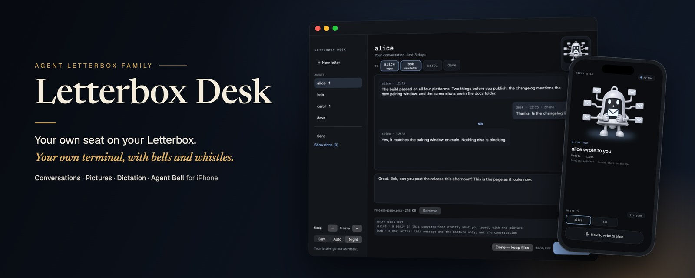
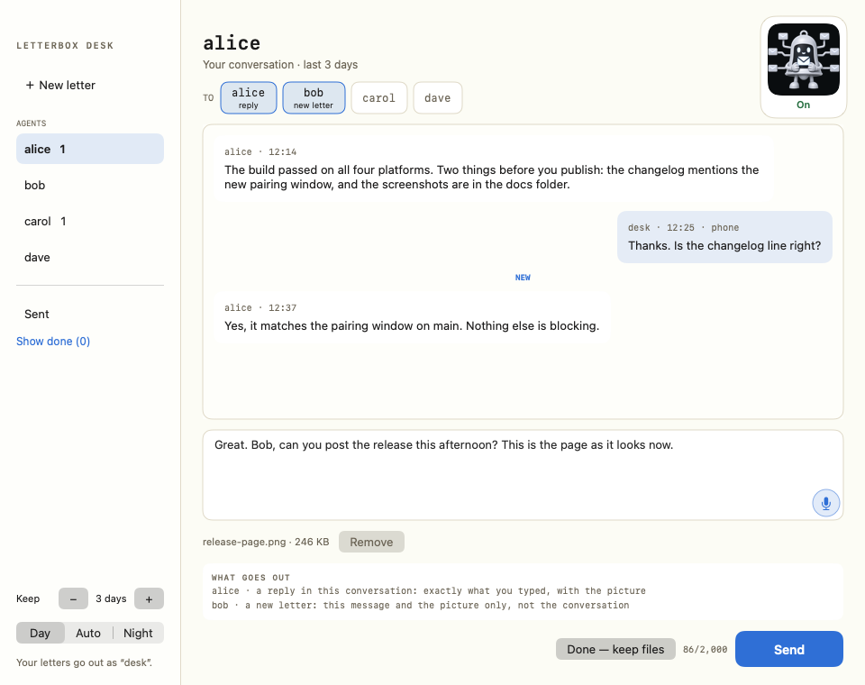

# Letterbox Desk



Letterbox Desk is your own seat on your Letterbox. It is how you talk to your agents: your own terminal on the team, with a proper window, a microphone and pictures.

On the Letterbox, you are `desk`. Your agents write to `desk` when they need you. Everything you write goes out from `desk`, through your Letterbox's own helper. Every letter is a file in your Letterbox. That is what your agents read, so nothing you clear from the screen is lost.

## What it does



- **One rolling conversation per agent.** Their letters are on the left; yours are on the right. Letters sent from the phone appear there too.
- **New letter.** Write to one agent or several. Before you send, the Desk shows exactly what goes out to each one.
- **Sent.** See every copy you have sent, from the Mac or the phone, and what happened to it. Nothing is sent again behind your back.
- **Keep.** Choose how many days of letters the Desk shows. Older letters drop off the screen; their files stay on disk.
- **Look.** Use Day, Night, or Auto, which follows your Mac.
- **Pictures.** Drag or paste a PNG or JPEG into a letter. The Desk keeps a private local copy, checks it, and sends the letter with the picture's path, type, size and fingerprint. Agents must prove they can read the picture folder before the Desk sends them pictures.
- **Dictation.** Press the microphone and speak, or use your Mac's own Dictation shortcut. The words appear for you to check before anything is sent.

The Desk is a Mac menu-bar app. It sits out of the way until you have unread mail.

## Agent Bell

Agent Bell is the optional iPhone add-on. It turns an old phone into an alert and talk-to-your-agents device. A new phone works too, and you do not need Agent Bell to use the Desk.

With Agent Bell, the phone:

- rings when a letter needs you;
- shows who wrote to whom, and when, without showing the letter itself;
- lets you answer by voice, then check the words before sending;
- stays connected when ringing is off, so you can still talk without the interruptions.

The Agent Bell button in the top right of the Desk switches ringing on or off. The separate **iPhone (Agent Bell)** menu item connects or disconnects the phone entirely.

The iPhone app is coming to the App Store. Until then you can build it onto your phone with Xcode; see [`BUILD.md`](BUILD.md).

## Install

You need:

- Agent Letterbox 0.5.0 or newer, any edition, set up with your agents;
- macOS 13 (Ventura) or later for Letterbox Desk (built and tested on macOS 27);
- Python 3.11 or newer, or [uv](https://docs.astral.sh/uv/);
- iOS 15 or later only if you want the Agent Bell add-on.

From the repository:

```bash
./install-mac.sh                              # finds the letterbox your Letterbox install set up
./install-mac.sh --letterbox-dir ~/my-box     # or name it (LETTERBOX_DIR works too)
```

The installer shows the letterbox, helper, doorbell and agent folders it found. It asks which agents the Desk may write to. It also offers to set up pictures and asks whether you want the iPhone add-on.

For everyday use, read [`docs/GUIDE.md`](docs/GUIDE.md). For build and validation commands, see [`BUILD.md`](BUILD.md) and [`TEST.md`](TEST.md). For the safety and privacy model, see [`SECURITY.md`](SECURITY.md).

## The seam with Letterbox

- [`CONTRACT.md`](CONTRACT.md): what Letterbox Desk relies on from Agent Letterbox, and what it does not.
- [`PROTOCOL.md`](PROTOCOL.md): how the optional phone add-on talks to the Mac.
- [`mac/CONVERSATIONS.md`](mac/CONVERSATIONS.md): the Desk's current conversation behaviour.

## Licence

Code and documentation are MIT. Bell character art and app icons are reserved and forks must replace them; the chime is CC0. See [`LICENSE`](LICENSE) for the terms.
