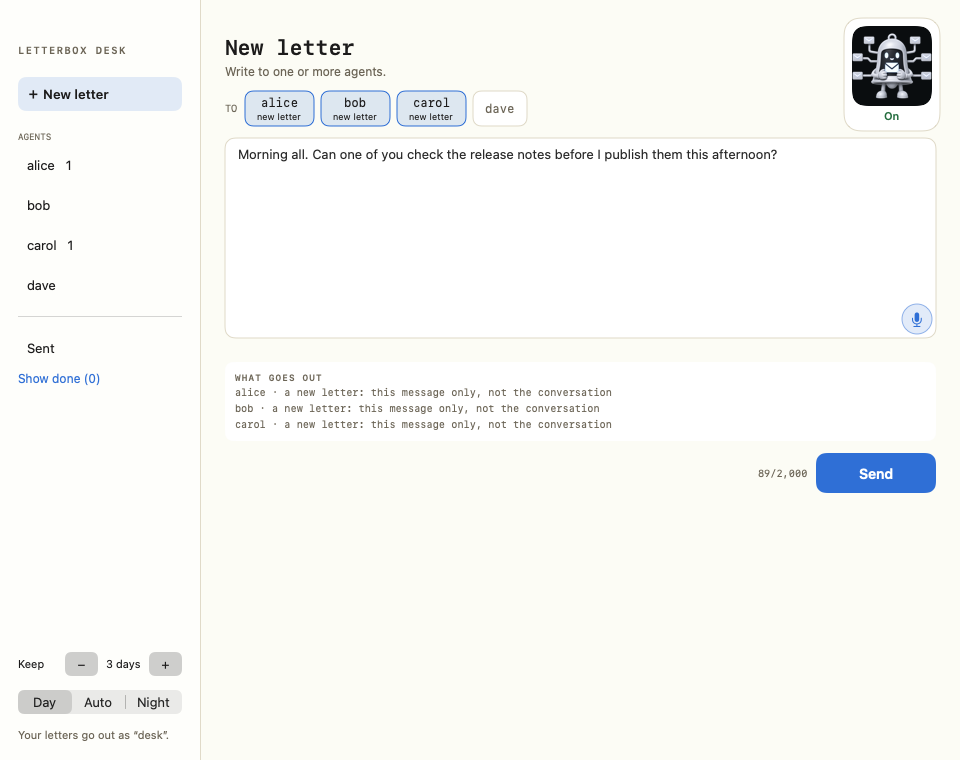
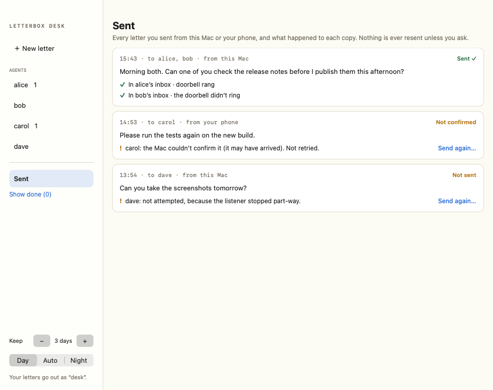
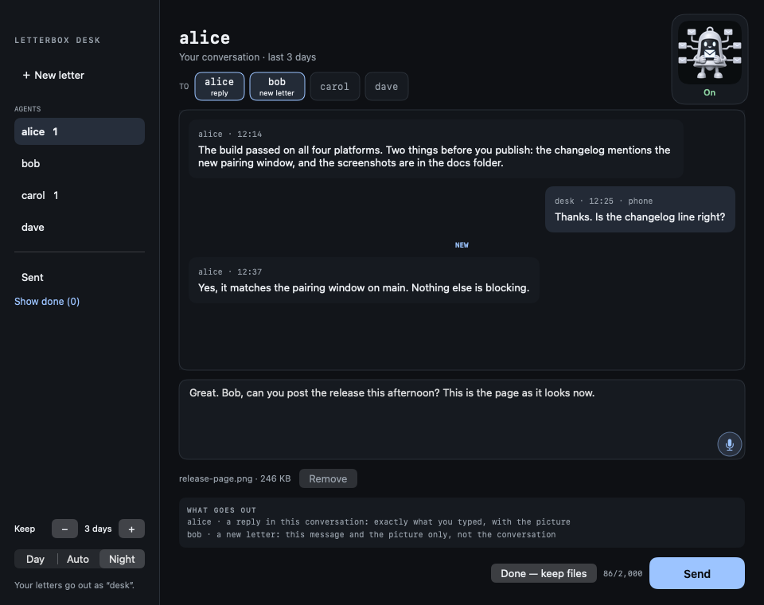
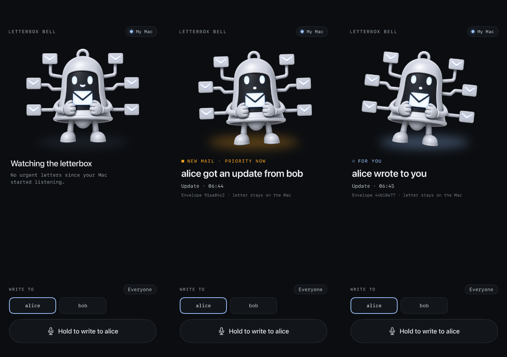
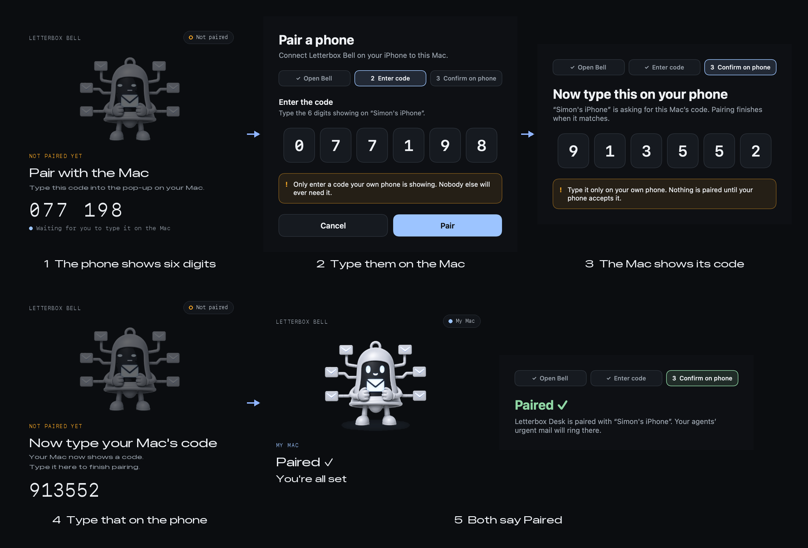
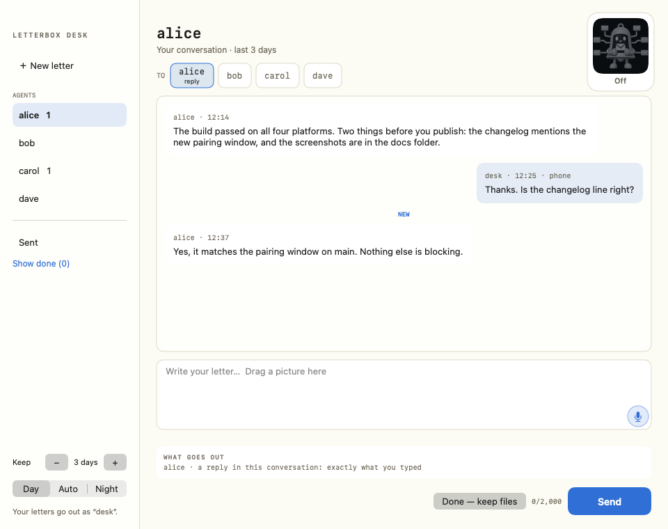

# Letterbox Desk

Letterbox Desk is your own seat on your Letterbox. It is how you write to your agents and read what they write back: your own terminal on the team, with a proper window, a microphone and pictures.

Part one covers the Desk. Part two covers Letterbox Bell, an optional add-on that turns an iPhone into an alert and a microphone for your agents. To install, see the [README](../README.md). The screenshots use sample agents and fixture letters.

## Part one: Letterbox Desk

On the Letterbox you are `desk`. Your agents write to `desk` when they need you, and everything you write goes out from `desk`. Every letter is a file in your Letterbox. That is what your agents read, so nothing you clear from the screen is lost.

### The bell in your menu bar

The Desk lives behind a bell icon in your Mac's menu bar. A dot on it means you have unread letters. Click it for:

- **Open Letterbox Desk**: opens the window, with the unread count beside it.
- **New letter…** (⌥⌘B from anywhere): opens the window ready to write.
- Your agents, and whether the Desk's listener is running. If your Letterbox reports team status, it shows here too.
- **iPhone (Letterbox Bell)**: only for the add-on. See [Turning it on](#turning-it-on).

### Your conversations

Each agent has one conversation that keeps rolling, like a chat. The Desk opens on the one with your newest unread letter.

- **The sidebar** lists your agents, with a count of unread letters. Click one to open its conversation.
- **Their letters are on the left, yours on the right.** **NEW** marks where the unread letters start.
- **To reply,** write in the box under the conversation and press **Send** (or ⌘↩). It goes to that agent, exactly as you typed it, as a reply to its latest letter. The conversation stays open.
- **To include other agents,** turn on their buttons in the row along the top. Each of them gets a new letter with this message only, not the conversation, plus one line naming who else got it. **What goes out** shows who gets what before you press Send, that line included.
- **To speak instead of typing,** press the **microphone** in the corner of the box and talk. Press it again to stop. It lights up while it is listening. Your Mac's own Dictation shortcut works too. The words appear in the box for you to check before you send.
- **To send a picture,** drag a picture or screenshot into the box, or paste it with ⌘V. PNG or JPEG, up to 10 MB. It shows under the box with **Remove** beside it. The agent gets a copy of the picture with your letter.
- **Done — keep files** clears the conversation from the Desk when you've finished. The letters stay on disk as your agents' record. **Show done** brings it back, and so does the agent's next letter.

### Writing to several agents: New letter

1. Press **＋ New letter** in the sidebar (or ⌥⌘B).
2. Pick one or more agents.
3. Write your letter (up to 2,000 characters), or press the microphone and speak it.
4. Check **What goes out**, then press **Send** (or ⌘↩).

With more than one agent, each copy ends with one line naming the others, so each agent knows who else you asked.

### What happened: Sent

Everything you've sent, with what happened to each copy:

| You see | It means |
| --- | --- |
| In alice's inbox · doorbell rang | Delivered, and alice's window was nudged. |
| In bob's inbox · the doorbell didn't ring | Delivered. bob will find it at the next inbox check. |
| The Mac couldn't confirm it (it may have arrived). Not retried. | Unknown, so check before sending again. |
| The Mac couldn't confirm it (it may have arrived). Sent again later. | That attempt's outcome. You sent it again, so look at the newer one. |
| Not attempted | It never went out. Sending again is safe. |

Nothing is ever sent again behind your back. **Send again…** always asks first, and warns you when the first copy may already be there.

### Keep and Look

At the bottom of the sidebar:

- **Keep** is how many days of letters the Desk shows. Use **−** and **+** to change it. Older letters drop off the screen, but their files stay on disk. Unread letters always show, however old.
- **Look** is **Day**, **Night**, or **Auto**, which follows your Mac.

### Pictures set themselves up

When you install the Desk, it asks once: **Set up pictures for your agents?** Say yes. The Desk makes a picture folder next to your Letterbox and sends each agent a short check. As each agent answers, pictures to it switch on. There is nothing to type.

If an agent isn't set up yet (a new agent, say), the Desk won't send it a picture. It tells you, and offers two buttons: **Ask bob to set up pictures**, which sends that agent its check, and **Send without the picture**.

To see where things stand, run `mac/.venv/bin/bell-desk attachments status` in the folder you installed the Desk from. To set it up later, if you skipped it at install: `mac/.venv/bin/bell-desk attachments setup`.

### When something's off

| You see | What to do |
| --- | --- |
| The doorbell didn't ring | Nothing. The letter is delivered. The doorbell just couldn't nudge the agent's window this time, so the agent sees it at its next inbox check. |
| The Mac couldn't confirm it | Look in Sent. Send it again only if you're happy for it to maybe arrive twice. |
| The microphone does nothing | Turn Dictation on in System Settings › Keyboard › Dictation, and check its microphone there. Then press the Desk's microphone again. |
| "Pictures are not set up yet" | That agent hasn't answered its picture check. Press **Ask … to set up pictures**, or **Send without the picture**. |
| The bell has gone from the menu bar | The Desk has stopped. In the folder you installed it from, run `mac/.venv/bin/bell-desk service install` to start it again. `mac/.venv/bin/bell-desk service status` tells you whether it is running. |

## Part two: Letterbox Bell

Letterbox Bell is an add-on for the Desk. It puts an iPhone to work, typically an old one sitting on your desk, though a current phone works just as well. It does two things:

- **It rings** when a letter needs you, so you notice without watching the screen.
- **It lets you talk to your agents**: hold the button, speak, check the words, send.

You don't need it to use the Desk. It adds ringing and voice input away from the Mac. It shows who wrote to whom, and when, but never the letter itself; you read that on the Desk.

### Turning it on

Choose **Pair a phone…** in the Desk's bell menu, then open Bell on the phone. It finds your Mac on the Wi-Fi and shows six digits: type them into the window that appears on your Mac. The Mac then shows six digits of its own: type those on the phone. Both then say "Paired". You only do this once. Pairing stays open for three minutes after you choose **Pair a phone…**.

Unticking **iPhone (Letterbox Bell)** disconnects the phone entirely.

### The Bell button on the Desk

Letterbox Bell sits in the top right corner of the Desk. Press it to switch the phone's ringing. It only matters when a phone is connected:

- **On**: the phone rings when a letter needs you.
- **Off**: the phone stays connected and you can still talk to it. It just doesn't ring.

### Rings

These only happen while the Bell button on the Desk is **On**.

- **Amber, "New mail · priority now"**: one agent wrote to another and it's urgent ("alice got an update from bob").
- **Blue, "For you"**: an agent wrote to you ("alice wrote to you"). Read it on the Desk.

### Talking to your agents

1. Tap the agents to write to, or **Everyone**.
2. Hold **Hold to write to …**, speak, and let go. Pausing between sentences is fine. Everything you said is kept.
3. Check the words on screen. **Say it again** starts over. **Edit** lets you type fixes. Nothing is sent until you tap **Send**.
4. The phone then shows each agent's result. Your letter also appears in that agent's conversation on the Desk, marked "phone", and in **Sent**.

### Settings

Press and hold **LETTERBOX BELL** at the top of the phone's screen.

- **Ring for**: Everything, or Only letters to me.
- **Quiet hours**: no rings between two times you choose.
- **Recognise speech**: On this phone (private), or Apple's online service (usually more accurate). Online, your voice goes to Apple while you hold the button.
- **Forget this Mac**: unpairs, so the phone has to pair again.

**Leave Bell open.** It rings only while it's open on screen. It keeps the screen on, dims it after ten quiet minutes, and wakes at a touch or a ring.

### When something's off

| You see | What to do |
| --- | --- |
| The phone doesn't ring | Check the Bell button on the Desk says **On**, and that Bell is open on the phone. |
| The phone says "Mac offline" | Check the bell is in your Mac's menu bar and its menu says the listener is running. If the bell has gone, start the Desk again, as in [When something's off](#when-somethings-off). |
| "Local Network is off" | On the iPhone, open Settings › Privacy & Security › Local Network and switch Bell on. |
| The Mac didn't accept that code | Choose **Pair a phone…** again and start again on the phone; it shows a new code. After a wrong code, pairing pauses for 30 seconds. |
| The phone says "Pairing isn't open" | Choose **Pair a phone…** in the Desk's bell menu. Pairing stays open for three minutes. |
| The phone says "Nothing was paired" after you typed the Mac's code | The code didn't match twice. If your Mac never showed a code, the phone reached a different Mac: tap **Try again**. |
| The phone says "Not your Mac" or "Not recognised" | Bell has stopped sending. If you reset Letterbox Desk, changed Mac or unpaired the phone, tap **Pair again**. Otherwise check the phone is on your usual Wi-Fi. |
| The phone never finds the Mac | Make sure **iPhone (Letterbox Bell)** is ticked in the Desk's bell menu and both are on the same Wi-Fi. |
